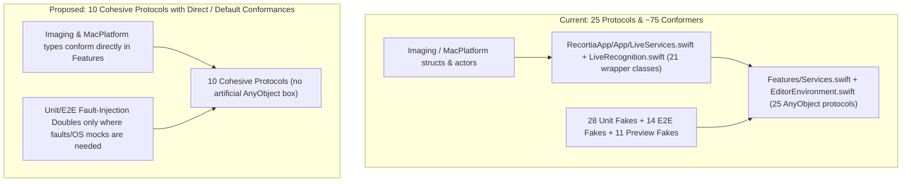

# Architecture second opinion

Source: Gemini (agy plan mode), read-only architecture second opinion at b2726b4, 2026-11-19. Raw output; the coordinator's verdicts are in `../review-list.md`.

Marcus, here is the architectural second opinion and ranked simplification plan based on the eleven reviewed files.

---

## Executive Diagnosis

The largest source of unnecessary surface area in Recortia is a **double-abstraction seam inside the same SwiftPM package**:

1. In [Package.swift](../../../../Packages/RecortiaKit/Package.swift), `Features` **already depends directly on `Domain`, `Imaging`, and `MacPlatform`**.
2. Yet [Services.swift](../../../../Packages/RecortiaKit/Sources/Features/Services.swift) and [EditorEnvironment.swift](../../../../Packages/RecortiaKit/Sources/Features/EditorEnvironment.swift) re-declare 25 `@MainActor public protocol ... : AnyObject` boundaries that mirror types already in `Imaging` and `MacPlatform`—often with byte-for-byte identical method signatures (`PrivacyRenderer` vs `RenderService`, `TextRecognizer` vs `TextRecognitionService`, `QRDecoder` vs `QRDecodingService`, `ClipboardSink` vs `ClipboardSinkService`, `KeychainPreferenceIntegrity` vs `PreferenceIntegrityService`).
3. Because every protocol in [Services.swift](../../../../Packages/RecortiaKit/Sources/Features/Services.swift) is constrained to `: AnyObject` and `@MainActor`, the `Sendable` value types (`struct PrivacyRenderer`, `struct ExportPipeline`, `struct TextRecognizer`, `struct QRDecoder`, `struct ClipboardSink`, `struct FileSink`) and actors (`actor ImageStore`, `actor ScreenCaptureService`) in `Imaging` and `MacPlatform` cannot conform directly. That forced the creation of 21 reference-type wrapper classes in [LiveServices.swift](../../../../RecortiaApp/App/LiveServices.swift) and [LiveRecognition.swift](../../../../RecortiaApp/App/LiveRecognition.swift)—none of which use a single app-target-only symbol—plus 3× redundant fakes across unit tests, E2E synthetics, and SwiftUI previews.

By **conforming `Imaging` and `MacPlatform` types directly (or via default implementations in `Features`)**, **merging single-method and co-implemented protocols**, **making `AppServices` non-optional on `AppModel`**, **pushing document mutation admission down into `Domain.Document`**, and **centralizing `SpacePolicy` + `AppPresence` window/alert presentation**, we can cut the protocol count from **25 to 10**, delete **~1,850–2,250 lines** across live adapters, duplicate fakes, and boilerplate, and make the core security/correctness invariants structural rather than convention-dependent.



---

## Key Design Decisions & Trade-offs

| Decision | Chosen Approach | Strongest Viable Alternative | Why the Chosen Approach Wins |
| :--- | :--- | :--- | :--- |
| **In-memory `Imaging` boundaries (`ImageStore`, `PrivacyRenderer`, `ExportPipeline`, `ScrollStitcher`)** | Keep a single merged `ImagePipelineService` protocol (covering asset registration, `render`/`renderBase`, and `makeSnapshot`) and `ScrollStitchService`, but **move the real `Imaging`-backed implementations into `Features` as the default implementation**. | Delete the protocols entirely and pass concrete `ImageStore`, `PrivacyRenderer`, and `ExportPipeline` everywhere, adding fault-injection closures onto those structs for tests. | Unit tests (`FeaturesTests`) actively inject faults (`.budgetExceeded`, `.renderFailed`, `.encodeFailed`, decode failures, async render barriers). Moving the real implementation into `Features` as the default deletes `LiveImageAssets`, `LiveRenderer`, `LiveExporter`, `LiveStitcher`, and **all Preview and E2E fakes** that only wanted working in-memory imaging, while keeping clean fault-injection fakes in `FeaturesTests`. |
| **OS/Side-Effect Protocols in `Services.swift` and `EditorEnvironment.swift`** | Merge co-owned 1–2 method protocols along hardware/OS capability boundaries (25 → 10 protocols) and drop `: AnyObject` where the production implementation is a value type or closure. | Keep 25 fine-grained protocols (Interface Segregation Principle) and only move `LiveServices.swift` into `Features`. | Moving `LiveServices.swift` without merging protocols leaves ~53 fake types across `FeaturesTests`, `E2E`, and Previews intact. Merging co-implemented pairs (`TextRecognition` + `QRDecoding`, `GitHubUpload` + `GitHubCredential`, `FileSink` + `SaveFolder`, `ClipboardSink` + `TextClipboard`, permissions into their owning capture/scroll services) cuts conformer classes across all 4 suites simultaneously. |
| **`AppModel` preview wiring (`services: AppServices?`)** | Make `services: AppServices` and `features` **non-optional** on `AppModel` by providing `AppServices.preview` (backed by the real in-memory `Imaging` pipeline and inert OS no-ops). | Keep `services: AppServices?` and `features: FeatureModels?` with optional chaining. | `services == nil` is a scaffolding leftover ([AppServices.swift](../../../../RecortiaApp/App/AppServices.swift)). Removing the nil state deletes `FeatureModels?` optional chaining across 10 methods in [AppModel.swift](../../../../RecortiaApp/App/AppModel.swift) and Settings views, checking wiring once at `init`. |

---

## Ranked Simplification Plan

### Rank 1: Move Live `Imaging` & `MacPlatform` Conformances into `Features` and Drop `: AnyObject` Wrapper Boxes
** Approx. lines deleted:** ~550–700 lines (including ~260 lines in `RecortiaApp/App/` and ~300–440 lines of duplicate Preview and E2E pass-through fakes)  
**Risk:** Low (mechanical move of stateless/actor adapters into `Features` or `MacPlatform`; no behavioral change)

#### Why
Every adapter in [LiveServices.swift](../../../../RecortiaApp/App/LiveServices.swift) and [LiveRecognition.swift](../../../../RecortiaApp/App/LiveRecognition.swift) depends only on `Domain`, `Imaging`, `MacPlatform`, and `AppKit`—all already dependencies of `Features` or `MacPlatform` ([Package.swift](../../../../Packages/RecortiaKit/Package.swift)). Furthermore:
- `PrivacyRenderer` ([module-contracts.md](../../../../docs/architecture/module-contracts.md)) already has the exact `render(_:scale:)` and `renderBase(_:scale:)` signatures of `RenderService` ([Services.swift](../../../../Packages/RecortiaKit/Sources/Features/Services.swift)).
- `TextRecognizer` and `QRDecoder` ([module-contracts.md](../../../../docs/architecture/module-contracts.md)) already have the exact signatures of `TextRecognitionService` and `QRDecodingService` ([Services.swift](../../../../Packages/RecortiaKit/Sources/Features/Services.swift)).
- `ClipboardSink` ([module-contracts.md](../../../../docs/architecture/module-contracts.md)) already has the exact `write(_:)` signature of `ClipboardSinkService` ([Services.swift](../../../../Packages/RecortiaKit/Sources/Features/Services.swift)).
- `KeychainPreferenceIntegrity` ([LiveServices.swift](../../../../RecortiaApp/App/LiveServices.swift)) already has the exact signature of `PreferenceIntegrityService` and required `@retroactive` only because the conformance was placed in `RecortiaApp`.
- `SystemClock` ([AppServices.swift](../../../../RecortiaApp/App/AppServices.swift)) is 7 lines of `Date()` and `Task.sleep(for:)` that belongs in `Features` as the default `FeatureClock`.

#### Concrete Changes
1. Remove `: AnyObject` from value-compatible protocols in [Services.swift](../../../../Packages/RecortiaKit/Sources/Features/Services.swift) so `PrivacyRenderer`, `ExportPipeline`, `TextRecognizer`, `QRDecoder`, `ClipboardSink`, `FileSink`, and `SystemClock` conform directly without wrapper classes.
2. Move `@concurrent` decode/canonicalize helpers from `LiveImageAssets` ([LiveServices.swift](../../../../RecortiaApp/App/LiveServices.swift)) and `ExportError -> ExportFailure` mapping from `LiveExporter` ([LiveServices.swift](../../../../RecortiaApp/App/LiveServices.swift)) into `Features` (or `Imaging`), and move `StitchEngine` / `LiveStitcher` ([LiveRecognition.swift](../../../../RecortiaApp/App/LiveRecognition.swift)) into `Features`.
3. Use real `ImageStore` + `PrivacyRenderer` + `ExportPipeline` + `LiveStitcher` in SwiftUI Previews and E2E instead of fake render/export/asset conformers, structurally guaranteeing Invariants #1 (`ExportPipeline -> ShareSnapshot`) and #2 (source-pixel redaction before resampling) across all non-fault-injected targets.

#### Files Touched
- **Delete:** [LiveServices.swift](../../../../RecortiaApp/App/LiveServices.swift), [LiveRecognition.swift](../../../../RecortiaApp/App/LiveRecognition.swift) (remaining wiring moves to [AppServices.swift](../../../../RecortiaApp/App/AppServices.swift))
- **Modify:** [Services.swift](../../../../Packages/RecortiaKit/Sources/Features/Services.swift), [AppServices.swift](../../../../RecortiaApp/App/AppServices.swift), [module-contracts.md](../../../../docs/architecture/module-contracts.md), plus E2E/Preview fake files that currently duplicate `ImageAssetService`, `RenderService`, `ExportService`, and `ScrollStitchService`.

---

### Rank 2: Consolidate 25 Service Protocols Down to 10 Cohesive Capability Boundaries
**Approx. lines deleted:** ~500–650 lines (across `Services.swift`, `EditorEnvironment.swift`, `AppServices.swift`, and ~40 fake conformances in tests/E2E/previews)  
**Risk:** Low–Medium (touches test fake declarations in `FeaturesTests` and E2E; fault injection capabilities remain 1:1)

#### Why
Fifteen of the 25 protocols in [Services.swift](../../../../Packages/RecortiaKit/Sources/Features/Services.swift) and [EditorEnvironment.swift](../../../../Packages/RecortiaKit/Sources/Features/EditorEnvironment.swift) are either 1-method closures, pairs already implemented by the exact same class in production, or sub-steps of a single coordinator's dependency:

#### Concrete Merges & Deletions (25 → 10 Protocols)

| Protocols Today (25) | Target Boundary (10) | Concrete Change |
| :--- | :--- | :--- |
| 1. `ImageAssetService`<br>2. `RenderService`<br>3. `ExportService` | **`ImagePipelineService`** (1) | All three wrap one `ImageStore` ([LiveRecognition.swift](../../../../RecortiaApp/App/LiveRecognition.swift)). Merge into one protocol with a default `LiveImagePipeline(store:)` in `Features`. Fault-injecting tests override only the method under test (`render`, `makeSnapshot`, or `importImage`). |
| 4. `CaptureService`<br>5. `ScreenPermissionService` | **`CaptureService`** (2) | Fold `var isScreenPermissionGranted: Bool` and `func requestScreenPermission() async -> Bool` into `CaptureService`. Deletes `ScreenPermissionService` and `LiveScreenPermission` ([LiveServices.swift](../../../../RecortiaApp/App/LiveServices.swift)). |
| 6. `ScrollFrameSourceService`<br>7. `AutoScrollService`<br>8. `AccessibilityPermissionService` | **`ScrollCaptureService`** (3) | Only `ScrollSessionModel` uses these ([AppModel.swift](../../../../RecortiaApp/App/AppModel.swift)). Fold `AccessibilityPermissionService` (`isTrusted`, `requestWithPrompt()`) and optional `autoScroller` step/stop/isAtEnd into one scroll capture boundary. |
| 9. `ScrollStitchService` | **`ScrollStitchService`** (4) | Keep protocol for scripted `ScrollAppendResult` unit tests; move `LiveStitcher` ([LiveRecognition.swift](../../../../RecortiaApp/App/LiveRecognition.swift)) into `Features` as the default implementation. |
| 10. `TextRecognitionService`<br>11. `QRDecodingService` | **`RecognitionService`** (5) | [LiveRecognition.swift](../../../../RecortiaApp/App/LiveRecognition.swift) already implements both on `LiveRecognition`. Merge into one 3-method protocol (`supportedLanguages`, `recognize`, `decode`). |
| 12. `FileSinkService`<br>13. `SaveFolderService`<br>14. `ImageInputService` | **`FileSystemService`** (6) | Merge local file read (`readFile`), atomic snapshot save (`save`, `saveUnique`), and bookmark resolution (`resolveFolder(bookmark:)`) into one local filesystem boundary. Move `LiveSaveFolders.resolveFolder` ([LiveServices.swift](../../../../RecortiaApp/App/LiveServices.swift)) into `MacPlatform.FileSink`. |
| 15. `ClipboardSinkService`<br>16. `TextClipboardService` | **`ClipboardService`** (7) | Both read/write `NSPasteboard` (`write(_ snapshot: ShareSnapshot)`, `writePlainText(_ text: String)`, and `readPasteboardImage() -> Data?`). Putting all three on `MacPlatform.ClipboardSink` deletes `TextClipboardService` ([EditorEnvironment.swift](../../../../Packages/RecortiaKit/Sources/Features/EditorEnvironment.swift)) and `PasteboardTextClipboard`. |
| 17. `DragSinkService` | **`DragSinkService`** (8) | Keep as-is (`ExportLease` lifecycle is distinct and security-critical). |
| 18. `GitHubUploadService`<br>19. `GitHubCredentialService` | **`GitHubService`** (9) | `LiveGitHubUpload` already implements both ([LiveRecognition.swift](../../../../RecortiaApp/App/LiveRecognition.swift)). Merge into one 3-method protocol (`upload`, `store`, `remove`). |
| 20. `ShortcutRegistry` | **`ShortcutRegistry`** (10) | Keep as-is (4 cohesive shortcut registration methods). |
| 21. `PreferenceStorage`<br>22. `PreferenceIntegrityService`<br>23. `LoginItemService`<br>24. `FeatureClock`<br>25. `ExternalLinkOpenerService` | **Value structs / closures (0 protocols)** | Replace single-method/pair plumbing protocols with small `@MainActor` value structs holding closures (with `.live` and `.inMemory` / `.test` static factories): `PreferenceStore` (combining storage + seal verification), `Clock` (defaulting to `Date()` / `Task.sleep`), `LoginItemControl` (2 closures), and `openExternalLink: @MainActor (URL) -> Bool` on [EditorEnvironment.swift](../../../../Packages/RecortiaKit/Sources/Features/EditorEnvironment.swift). Also remove `input: any ImageInputService` and `assets: any ImageAssetService` from `EditorEnvironment` once `imageImporter` is non-optional and `pipeline` owns `release(_:)`, shrinking `EditorEnvironment` from 12 fields to 8. |

#### Files Touched
- **Modify:** [Services.swift](../../../../Packages/RecortiaKit/Sources/Features/Services.swift), [EditorEnvironment.swift](../../../../Packages/RecortiaKit/Sources/Features/EditorEnvironment.swift), [AppServices.swift](../../../../RecortiaApp/App/AppServices.swift), [AppModel.swift](../../../../RecortiaApp/App/AppModel.swift), and the coordinator initializers/test doubles in `Features` and `FeaturesTests`.

---

### Rank 3: Move Pure `Document` Mutations & Admission Checks Out of `EditorModel` into `Domain.Document` and Unify Async Revision Gating
**Approx. lines deleted:** ~450–600 lines across `EditorModel*.swift` (shrinking `EditorModel` from ~2,400 lines across 10 files to ~1,800 lines across 4 files)  
**Risk:** Medium (touches core editor mutation paths and async cancellation tracking; fully covered by existing `FeaturesTests` and bilingual E2E gates)

#### Why
1. **Repeated validation ("Check data once where it enters and trust it after"):**
   In [EditorModel.swift](../../../../Packages/RecortiaKit/Sources/Features/EditorModel.swift), ~300 lines are pure `Document` value transformations (`deleteSelection`, `duplicateSelection`, `reorderSelection`, `static func reorder`, `static func translated`, `static func translate`, `static func setMaskRect`, `static func setFrame`, `setCrop`, `setResizeScale`). Because `Document` exposes raw mutable arrays (`layers`, `obfuscations`, `annotations`, `masks`, `callouts`, `assets`), `EditorModel` re-checks `.isFinite`, range clamping, `EditorGeometry.outwardIntegral`, `document.sourceRegions(for:)`, unused-asset pruning (`usedAssets`), and `validateArrowCurve` at every individual caller (`setLineWidth` at [L138-L147](../../../../Packages/RecortiaKit/Sources/Features/EditorModel.swift), `duplicateSelection` at [L522](../../../../Packages/RecortiaKit/Sources/Features/EditorModel.swift), `translate` at [L621](../../../../Packages/RecortiaKit/Sources/Features/EditorModel.swift), `setFrame` at [L701-L715](../../../../Packages/RecortiaKit/Sources/Features/EditorModel.swift)).
2. **Five hand-rolled stale-result state machines:**
   In [EditorModel.swift](../../../../Packages/RecortiaKit/Sources/Features/EditorModel.swift), `EditorModel` stores 11 separate properties (`baseTask`, `installedBaseKey`, `failedBaseKey`, `outputTask`, `installedOutputKey`, `failedOutputKey`, `recognitionRequest`, `recognizedResult`, `qrRequest`, `colorPickTask`, `colorPickRequest`) to implement the same `(requestID, revision, privacyEpoch)` staleness gate across `EditorModel+Preview.swift`, `EditorModel+Recognition.swift`, and `EditorModel+PixelTools.swift`.

#### Concrete Changes
1. **Push `Document` item admission & mutations into `Domain.Document` (or `Features/EditorDocument.swift`):**
   - Check geometry finiteness, mask integral snapping + `sourceRegions(for:)` derivation, arrow curve validity, and orphaned-asset pruning **once** inside `Document`'s mutation entry points (`delete(items:)`, `duplicate(items:offset:)`, `reorder(items:order:)`, `translate(items:dx:dy:)`, `setFrame(of:to:)`, `setMaskRect(at:to:)`, `setCrop(_:)`, `setResizeScale(_:)`).
   - Preserves Invariant #2 (secure masks always re-derive `sourceRegions` on creation, duplication, move, and resize) at the single `Document` mutation entry point rather than scattered across `EditorModel` methods.
2. **Extract one package-internal `RevisionedTask<Key>` helper for `EditorModel` async work:**
   - Captures `(requestID: UUID, revision: UInt64, privacyEpoch: UInt64)` when scheduled and validates `!model.isClosed && session.revision == stamp.revision && session.privacyEpoch == stamp.privacyEpoch` before committing results, incrementing `droppedResultCount` on mismatch (preserving Invariant #3).
3. **Collapse the 10 `EditorModel*.swift` extension files into 4 cohesive files:**
   - `EditorModel.swift` (session state, tool/style, selection, undo/continuous changes, `edit(_:_:)`)
   - `EditorModel+Canvas.swift` (gestures, handles, text editing, curved arrows, pixel tools)
   - `EditorModel+Async.swift` (base/output preview rendering, OCR, QR)
   - `EditorModel+Export.swift` (export, pin, and image layer import actions)

#### Files Touched
- **Modify:** [EditorModel.swift](../../../../Packages/RecortiaKit/Sources/Features/EditorModel.swift) and its `EditorModel+*.swift` extensions; `Domain/Document.swift`.

---

### Rank 4: Make `AppServices` Non-Optional on `AppModel` and Inline `FeatureModels`
**Approx. lines deleted:** ~150–200 lines  
**Risk:** Low (eliminates dead nil-branching in `AppModel` and Settings views)

#### Why
In [AppServices.swift](../../../../RecortiaApp/App/AppServices.swift), the comment states: *"Until that wiring lands, the app runs with `services == nil` and every command that needs one of these is disabled rather than faked."* That wiring has already landed ([LiveRecognition.swift](../../../../RecortiaApp/App/LiveRecognition.swift)). Keeping `services: AppServices?` only for SwiftUI previews forces:
- `FeatureModels` ([AppModel.swift](../../../../RecortiaApp/App/AppModel.swift)) to exist as a separate wrapper struct used only by `AppModel`.
- `let features: FeatureModels?`, `var openDocument: ((DocumentSession) -> EditorModel?)?`, and `var recognizeText: ((DocumentSession) -> Void)?` ([AppModel.swift](../../../../RecortiaApp/App/AppModel.swift)) to be optional and lazily wired in `launch(kind:)`.
- Every command check and action in [AppModel.swift](../../../../RecortiaApp/App/AppModel.swift) and Settings panes to unwrap `features?.capture`, `features?.scroll`, `features?.importer`, `features?.export`, `features?.pins`, `openDocument != nil`, and `recognizeText != nil`.

#### Concrete Changes
1. Add `AppServices.preview(settings:)` in [AppServices.swift](../../../../RecortiaApp/App/AppServices.swift) using the real in-memory `Imaging` pipeline (from Rank 1) and inert no-op capture/sink implementations.
2. Make `services: AppServices` non-optional in `AppModel.init` ([AppModel.swift](../../../../RecortiaApp/App/AppModel.swift)), inline `FeatureModels` directly onto `AppModel` (`let capture`, `let export`, `let importer`, `let scroll`, `let pins`, `let ocrLanguages`, `let loginItem`), and wire callbacks once in `init`.
3. Replace optional `openDocument` / `recognizeText` hooks with direct calls to `editors.open(...)` (or a non-optional closure defaulting to `editors.open` if `AppModelTests` intercepts document opening).

#### Files Touched
- **Modify:** [AppServices.swift](../../../../RecortiaApp/App/AppServices.swift), [AppModel.swift](../../../../RecortiaApp/App/AppModel.swift), and Settings preview call sites.

---

### Rank 5: Centralize Ordinary-Window & Modal Presentation on `AppPresence` and Unify Alert Paradigms in `MessagePresenter`
**Approx. lines deleted:** ~180–220 lines  
**Risk:** Low–Medium (must preserve `SpacePolicy` at window construction, inactive presentation readiness in E2E, and `AppPresence` coalesced demotion invariants)

#### Why
1. **Four hand-sequenced window presentation paths + four modal presentation paths:**
   Every ordinary window (`EditorWindowController`, `SettingsWindowController`, `OnboardingWindowController`, `ScrollReviewWindowController`) and every modal dialog (`NSOpenPanel` in [AppModel.swift](../../../../RecortiaApp/App/AppModel.swift) and the three `NSAlert` methods in [MessagePresenter.swift](../../../../RecortiaApp/App/MessagePresenter.swift)) manually sequences:
   - `SpacePolicy.follow(window)`
   - `AppPresence.shared.windowWillAppear()` or `AppPresence.shared.activate()`
   - `makeKeyAndOrderFront(nil)` or `runModal()`
   - `defer { AppPresence.shared.setNeedsRefresh() }` (for modal panels/alerts that order out instead of posting `willCloseNotification`).
   Notice that in [MessagePresenter.swift](../../../../RecortiaApp/App/MessagePresenter.swift), `present(_:)` calls `AppPresence.shared.activate()` *before* `makeAlert(message)` applies `SpacePolicy.follow(alert.window)`, whereas `confirmDiscardScrollingCapture()` ([L42-L44](../../../../RecortiaApp/App/MessagePresenter.swift)) and `confirmDiscardOnQuit(count:)` ([L68-L70](../../../../RecortiaApp/App/MessagePresenter.swift)) call `SpacePolicy.follow(alert.window)` *before* `AppPresence.shared.activate()`! Hand-sequencing this in multiple places risks activating a window before its Space policy is attached (which switches Spaces out of a fullscreen app).
2. **Three alert paradigms:**
   - Value-type `UserMessage` routed through `AppModel.showMessage` ([MessagePresenter.swift](../../../../RecortiaApp/App/MessagePresenter.swift))
   - Separate `confirmQuit: (Int) -> Bool` closure on `AppModel` + static `MessagePresenter.confirmDiscardScrollingCapture()` building raw `NSAlert`s ([MessagePresenter.swift](../../../../RecortiaApp/App/MessagePresenter.swift))
   - Feature-local `EditorNotice` / `ScrollSessionModel.notice` mapped ad-hoc in `AppModel`.

#### Concrete Changes
1. **Add two presentation primitives to [AppPresence.swift](../../../../RecortiaApp/App/AppPresence.swift):**
   ```swift
   /// Configures SpacePolicy and promotes activation policy before showing an ordinary window.
   func presentOrdinaryWindow(_ window: NSWindow, activate: Bool = true) {
       SpacePolicy.follow(window)
       if activate {
           self.activate()
       } else {
           windowWillAppear()
       }
       window.makeKeyAndOrderFront(nil)
   }

   /// Attaches SpacePolicy before activating and refreshes Dock presence after modal order-out.
   func runModal<T>(for window: NSWindow, body: () -> T) -> T {
       SpacePolicy.follow(window)
       activate()
       defer { setNeedsRefresh() }
       return body()
   }
   ```
   *(Keep `SpacePolicy.follow(window)` at window construction time as well so no window ever exists without a policy, and use `presentOrdinaryWindow(_:activate:)` when showing Settings, Onboarding, ScrollReview, and Editor windows.)*
2. **Unify `MessagePresenter` around `UserMessage` and a single confirmation builder in [MessagePresenter.swift](../../../../RecortiaApp/App/MessagePresenter.swift):**
   - Replace the duplicated `NSAlert` builders in `confirmDiscardScrollingCapture()` and `confirmDiscardOnQuit(count:)` with one `UserConfirmation` value struct (`title`, `detail`, `confirmTitle`, `isDestructive`) executed via `AppPresence.shared.runModal(for: alert.window) { alert.runModal() == .alertFirstButtonReturn }`.
   - Use `AppPresence.shared.runModal(for: panel)` in `AppModel.chooseImageFile()` ([AppModel.swift](../../../../RecortiaApp/App/AppModel.swift)).

#### Files Touched
- **Modify:** [AppPresence.swift](../../../../RecortiaApp/App/AppPresence.swift), [MessagePresenter.swift](../../../../RecortiaApp/App/MessagePresenter.swift), [AppModel.swift](../../../../RecortiaApp/App/AppModel.swift), and the four ordinary window controllers (`EditorWindowController`, `SettingsWindowController`, `OnboardingWindowController`, `ScrollReviewWindowController`).

---

## Summary Table

| Rank | Change | Protocols Removed | Approx. Lines Deleted | Risk | Invariants Strengthened |
| :---: | :--- | :---: | :---: | :---: | :--- |
| **1** | Move live `Imaging`/`MacPlatform` conformances into `Features`; drop `: AnyObject` wrapper boxes and delete `LiveServices.swift` + `LiveRecognition.swift` + redundant E2E/Preview fakes | 0 (prepares Rank 2) | ~550–700 | **Low** | Structural `ExportPipeline -> ShareSnapshot` & `PrivacyRenderer` source-pixel mask execution in Previews and E2E |
| **2** | Consolidate 25 service protocols into 10 cohesive boundaries + value structs/closures; shrink `EditorEnvironment` from 12 to 8 fields | **15** (25 → 10) | ~500–650 | **Low–Medium** | Preserves all unit-test fault injection (`ExportFailure`, `SinkError`, `CaptureError`, `ImportError`) with ~40 fewer fake types |
| **3** | Push pure `Document` item mutations & admission checks into `Domain.Document`; unify `EditorModel` async `(requestID, revision, privacyEpoch)` tracking; merge 10 `EditorModel*.swift` files into 4 | 0 | ~450–600 | **Medium** | Single-entry admission for geometry/masks/arrow curves; single implementation of async revision/epoch staleness gate |
| **4** | Make `AppServices` non-optional on `AppModel` via `AppServices.preview`; inline `FeatureModels` and non-optional document hooks | 0 | ~150–200 | **Low** | Eliminates uninitialized/nil service states in `AppModel` |
| **5** | Centralize `presentOrdinaryWindow` and `runModal` on `AppPresence`; unify `NSAlert` and `UserConfirmation` in `MessagePresenter` | 0 | ~180–220 | **Low–Medium** | Guarantees `SpacePolicy.follow` runs before `AppPresence.activate()` on every window and modal alert |
| **Total** | | **25 → 10 protocols** | **~1,830–2,370 lines** | | All 4 core invariants + fault-injection testability preserved |

---

## Verification Order (When Executed)

Execute and commit in the order above (Rank 1 → Rank 2 → Rank 4 → Rank 5 → Rank 3, or Rank 1–5 sequentially), verifying each slice with:
1. `swift test --package-path Packages/RecortiaKit` after Ranks 1, 2, and 3.
2. `scripts/check.sh` (format lint, XcodeGen project freshness, doctor/isolation checks, full unit test suite, signed Debug build).
3. `scripts/e2e.sh --lang all` (under `.scratch/e2e.lock`) after Rank 5 to verify `space-policy`, `other-spaces`, `window-presence`, `last-window`, `editor-presentation`, and `automatic-export`.

